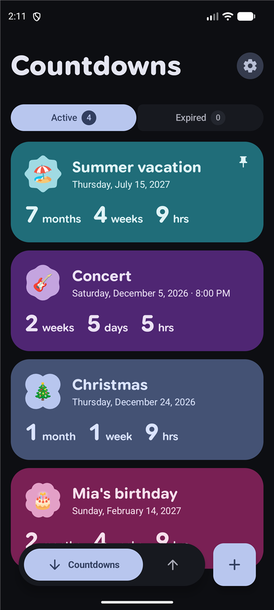
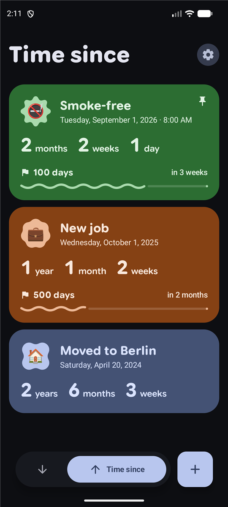
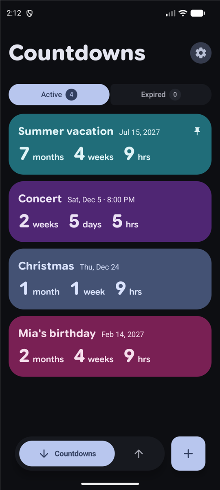
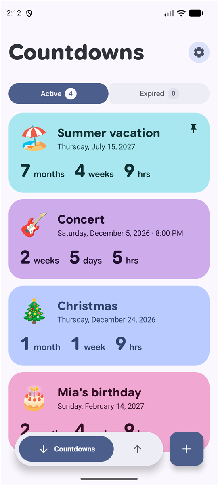
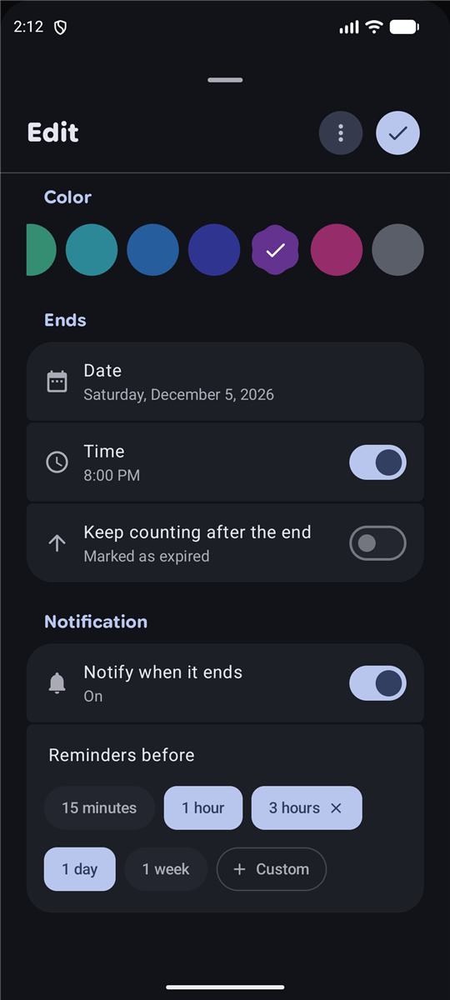
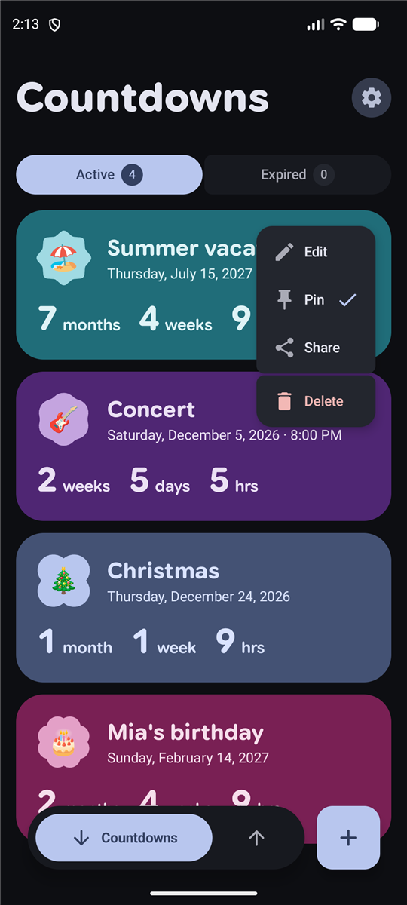
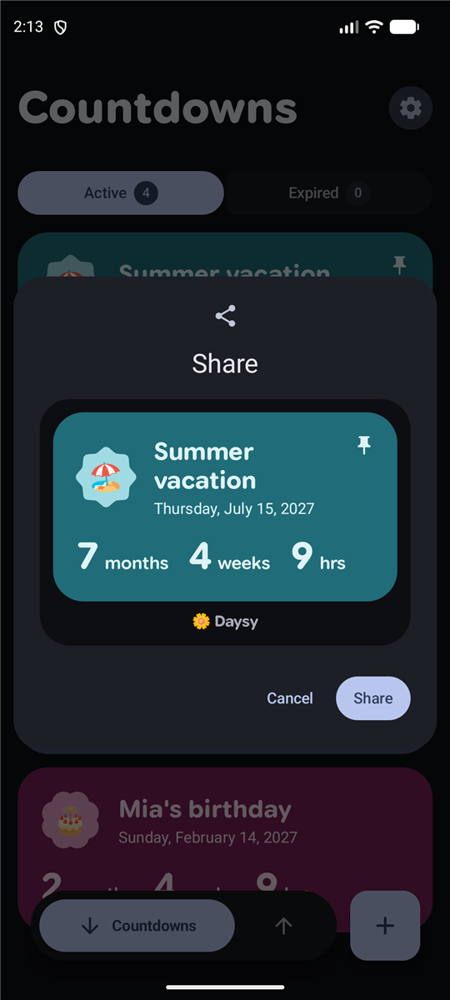

# Daysy 🌼

A simple, modern countdown app for Android – count down to the moments ahead and count up from the ones behind you. Built with Jetpack Compose in **Material 3 Expressive**.

**[Download the latest APK](https://github.com/devlueks/daysy/releases/latest)** · Android 8.0 or newer

<p>
  
  
  
  
</p>
<p>
  
  
  
</p>

<sub>From left: own card colors · "time since" with milestones · compact mode · light theme with free-standing emoji · several reminders · long-press menu · share as image</sub>

## Features

- **Countdowns and "time since"** – two tabs, swipe between them. Countdowns can keep counting up once they end.
- **Calendar-correct time** – years, months, weeks, days, hours and minutes; choose how many units are shown.
- **Make it yours** – an emoji (or any emoji from your keyboard) in a playful shape, plus 11 card colors or your system colors.
- **Milestones** – optional for "time since": 1 week, 100 days, 1 year … with a wavy progress bar and notifications.
- **Notifications** – when a countdown ends, plus up to 5 reminders before it (15 min, 1 hour, 1 day, 1 week or your own time).
- **Quick actions** – press and hold an entry to edit, pin, share, reset or delete it.
- **Share** – send a countdown as an image of its card, with the text alongside.
- **App shortcuts** – press and hold the app icon for "New countdown" or "New time since".
- **Home screen widgets** – look like the cards in the app and adapt to their size.
- **Compact mode**, light/dark theme, pinning, undo after deleting.
- **English and German** – follows your phone's language (per-app language on Android 13+).
- **Private** – no account, no ads, no tracking, no internet permission. Everything stays on your device.
## Building

Requirements: a recent Android Studio. Gradle runs on JDK 21 – the one bundled with Android Studio works.

```bash
./gradlew assembleDebug
```

The APK ends up in `app/build/outputs/apk/debug/`. Run the unit tests with `./gradlew testDebugUnitTest`.

- Min SDK 26 (Android 8.0), target SDK 36
- Kotlin, Jetpack Compose, Material 3 (Expressive APIs), Glance for widgets

## Translations

Texts live in `app/src/main/res/values/strings.xml` (English, default) and `values-de/strings.xml` (German). To add a language, copy the English file into `values-<code>/` and translate it, then add the code to `res/xml/locales_config.xml`.

## License

Code: [MIT](LICENSE) © devlueks.
Font: [Google Sans Flex](https://github.com/googlefonts/googlesans-flex), licensed under the [SIL Open Font License 1.1](licenses/GoogleSansFlex-OFL.txt).
